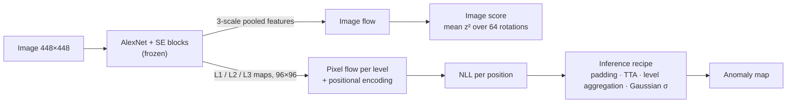
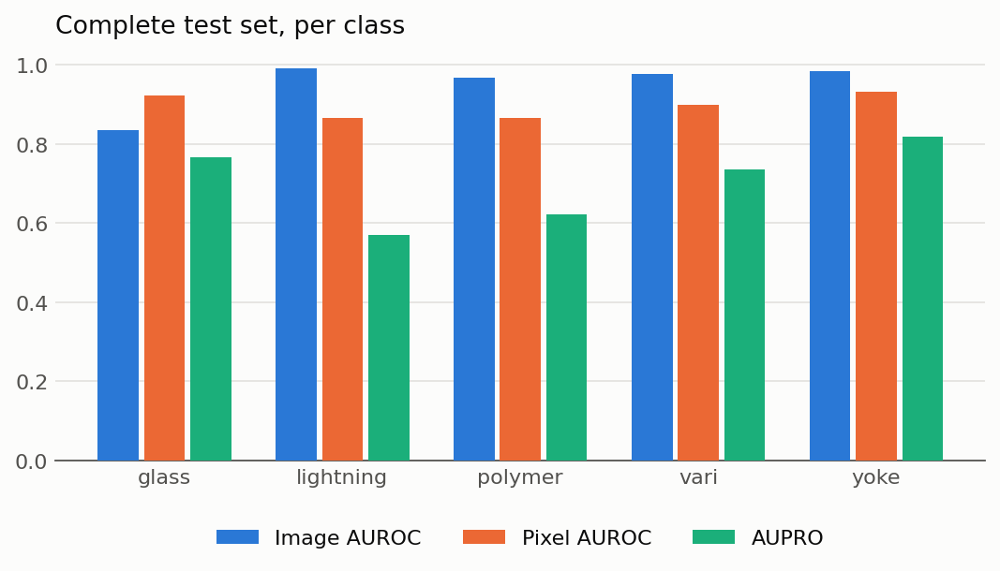
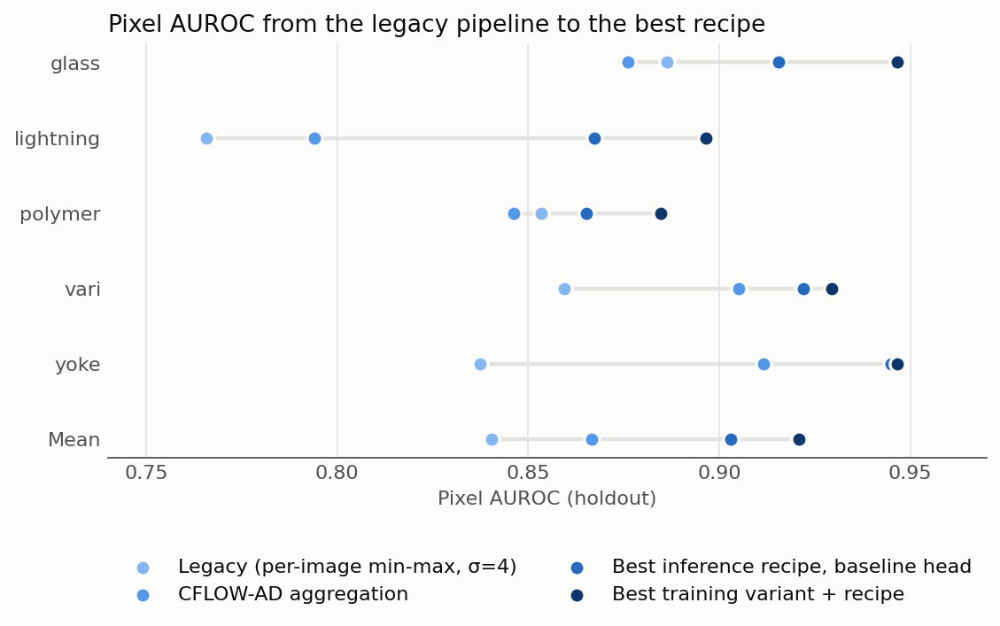
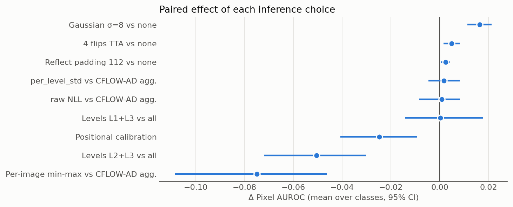
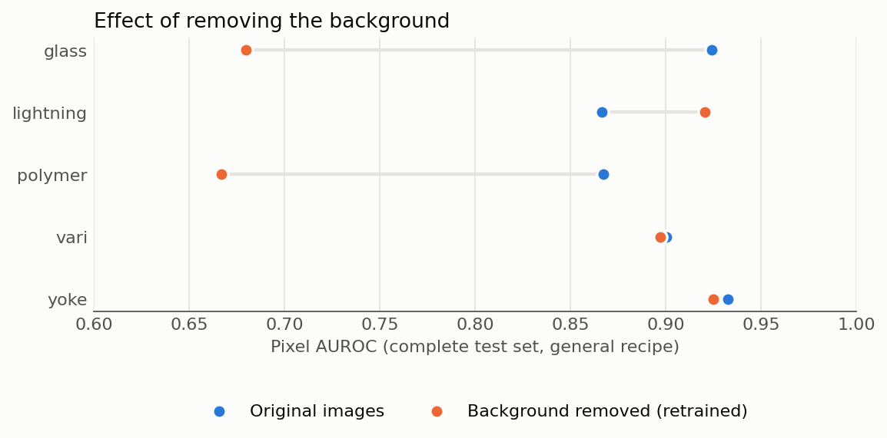

<div align="center">

# Post-Processing Beats Retraining: An Ablation Study of the Normalizing-Flow Head for Anomaly Localization in Power-Line Inspection

### Anonymous submission, under review


</div>

PyTorch implementation of **SEDifferNet + pixel NF head** for unsupervised anomaly detection and localization on aerial images of power transmission line components.

- Two heads per class: an image head (SEDifferNet) and a pixel head (a conditional normalizing flow on the frozen image-head features).
- One command trains both heads. Inference always uses both.
- The pixel-head *recipes* found in the ablation study ship as presets in `config.py`, and the best one for each class is the default.



## Abstract

Precise localization of defects in power-line components is central to UAV-based predictive maintenance. Normalizing-flow (NF) detectors learn the distribution of normal features and use the negative log-likelihood (NLL) as a per-pixel anomaly score. Work in this area concentrates on architectures and training, and the effect of inference-time choices on localization quality has received little attention. We run a systematic ablation of the pixel NF head of a SEDifferNet pipeline on the 5 classes of INSPLAD-seg. With the image encoder frozen, we vary 5 head-training variants and 8 inference factors (padding, test-time augmentation, score aggregation, feature levels, positional calibration, interpolation, Gaussian smoothing and image score), select recipes on a validation half of the test set and report them on the other half. The full recipe raises mean holdout Pixel AUROC from 0.8405 to 0.9208 (+0.080). About 78% of that gain comes from inference choices alone, with no retraining. Gaussian smoothing helps all 25 heads, per-image min-max normalization hurts (−0.075), and the best set of feature levels depends on the class and on the head. No single training variant wins on average (Friedman p = 0.72).

## 1. Environment

```bash
conda create -n sedifferent python=3.10
conda activate sedifferent
pip install -r requirements.txt
```

For GPU, install `torch`/`torchvision` from the index that matches your CUDA version (see the comment in `requirements.txt`). Experiments were run on a single 8 GB laptop GPU with PyTorch 2.5.1 + CUDA 12.1.

## 2. Prepare the dataset

### INSPLAD-seg

Download InsPLAD and its segmentation masks, then arrange each class in the MVTec AD layout:

```
insplad-seg/
|-- glass-insulator/
|   |-- train/good/*.png
|   |-- test/good/*.png
|   |-- test/<defect>/*.png
|   |-- ground_truth/<defect>/*.png      (same name as the image; _mask/_gt suffixes accepted)
|-- lightning-rod-suspension/
|-- polymer-insulator-upper-shackle/
|-- vari-grip/
|-- yoke-suspension/
```

Set `dataset_path` in `config.py` to the `insplad-seg` folder or pass `--dataset`.

| Class | Train (normal) | Test | Test anomalous | Typical defect |
|---|---:|---:|---:|---|
| glass-insulator | 1,104 | 678 | 87 | missing cap, ~0.14% of the image |
| lightning-rod-suspension | 462 | 163 | 46 | thin rust, ~1.9% |
| polymer-insulator-upper-shackle | 935 | 317 | 82 | wear / deformation, ~3.1% |
| vari-grip | 477 | 154 | 40 | extensive corrosion, ~4.6% |
| yoke-suspension | 4,834 | 1,253 | 46 | mechanical damage, ~2.0% |

### Background-removed version (optional)

`../yolo-segmentation/` contains the scripts that segment the component and paint the background black. Point `--dataset` to the generated folder to train on it.

## 3. Run experiments

Everything is configured in `config.py`; command-line arguments override it for one run.

**Train** (image head, then pixel head):

```bash
python train.py                                   # all classes
python train.py --classes vari-grip               # one class, best_per_class recipe
python train.py --classes vari-grip --recipe general
python train.py --classes vari-grip --print_recipe
```

**Evaluate** on the test set (Image AUROC/AP, Pixel AUROC/AP, AUPRO):

```bash
python evaluate.py                                # most recent run in runs/
python evaluate.py --model_dir runs/<timestamp> --classes vari-grip
```

**Infer** on a folder of images (scores, `.npy` maps and overlays):

```bash
python infer.py --classes vari-grip --input <image folder> --model_dir runs/<timestamp>
```

**Detailed evaluation** (ROC/PR curves, F1/IoU/Dice, error rankings, latency): `avaliacao_completa_pixel_heads.ipynb`.

**Tests:**

```bash
python -m pytest tests
```

### Pixel-head recipes

| Recipe | Head training | Inference |
|---|---|---|
| `best_per_class` (default) | winning variant per class (per-channel feature standardization and/or coupling clamp 1.9) | reflect/replicate padding 112, plus the winning TTA, score mode, levels, σ and image score for the class |
| `general` | baseline | reflect padding 112, 4-flip TTA, `per_level_std`, σ = 8; levels chosen per class |
| `baseline` | baseline | no padding or TTA, `raw`, all levels, σ = 4 |

When the dataset or class has no planned recipe, training falls back to `general` with all three levels and runs a quick level ablation at the end. The selected levels and the ablation table are stored in `pixel_head.pt`.

### Trained weights

Trained weights are not released with the anonymous submission. `train.py` reproduces them with the settings in `config.py`.

## Results

### A. Per-class metrics on the complete test set

Values in %. Image head: SEDifferNet with 64 rotations. Pixel head: `general` recipe. The complete test set (no split) is used, with 448×448 maps, stride 1 and no border cropping. Pixel AUROC and AP come from a 65,536-bin histogram. AUPRO follows the CFLOW-AD implementation (global thresholds, FPR ≤ 0.3).

| Class | Image AUROC | Pixel AUROC | Pixel AP | AUPRO |
|---|---:|---:|---:|---:|
| glass-insulator | 83.5 | 92.4 | 0.23 | 76.7 |
| lightning-rod-suspension | 99.1 | 86.6 | 2.48 | 57.1 |
| polymer-insulator-upper-shackle | 96.8 | 86.7 | 3.17 | 62.2 |
| vari-grip | 97.7 | 90.0 | 8.01 | 73.7 |
| yoke-suspension | 98.4 | 93.3 | 0.97 | 81.8 |
| **Mean** | **95.1** | **89.8** | **2.97** | **70.3** |

<div align="center">

</div>

Pixel AP is low because defects cover between 0.02% and 1.2% of the test pixels. Relative to that prevalence, AP is 4× to 13× above chance.

### B. From the legacy pipeline to the best recipe

Values in %: Pixel AUROC on the holdout half of the test set (60%). Recipes and training variants were selected on the validation half (40%), and the holdout never selected anything.

| Stage | glass | lightning | polymer | vari | yoke | **Mean** |
|---|---:|---:|---:|---:|---:|---:|
| Legacy (per-image min-max, σ = 4) | 88.6 | 76.6 | 85.3 | 85.9 | 83.7 | **84.1** |
| CFLOW-AD score aggregation | 87.6 | 79.4 | 84.6 | 90.5 | 91.2 | **86.7** |
| Best inference recipe, baseline head | 91.6 | 86.7 | 86.5 | 92.2 | 94.5 | **90.3** |
| Best training variant + its recipe | **94.7** | **89.7** | **88.5** | **93.0** | **94.7** | **92.1** |

<div align="center">

</div>

The recipe chosen on validation came within 0.0009 of the holdout oracle.

### C. Effect of each inference choice

Each row compares recipes that are identical except for one factor. The effect is averaged per head and then per class, with a 95% hierarchical bootstrap CI (classes, then heads).

<div align="center">

</div>

- **Helps every class:** Gaussian smoothing (σ = 8, positive for 25/25 heads), 4-flip TTA and reflect padding at inference.
- **Ties:** `raw`, `per_level_std` and the CFLOW-AD aggregation are equivalent in AUROC. The CFLOW-AD aggregation is better in AUPRO but depends on the evaluated cohort.
- **Hurts:** per-image min-max normalization, positional calibration and dropping L1.
- **Feature levels** depend on the class: L1+L3 matches all levels on average, but costs 0.044 on polymer. All three levels is the minimax choice, which is why it is the fallback.

### D. Background removal

The background-removed dataset (YOLO segmentation, black background) was used to retrain both heads. Each condition is evaluated on its own test set, and the two test sets differ slightly because some images were dropped during segmentation.

<div align="center">

</div>

Removing the background helps lightning-rod-suspension (+0.054) but hurts glass-insulator and polymer-insulator-upper-shackle by about 0.2. In those two classes the segmentation sometimes erases the missing or worn part. For vari-grip and yoke-suspension the difference is small.

### Protocol notes

- The datasets only have train and test splits. The released code selects the image-head epoch on the test Image AUROC and the pixel-head epoch on the test Pixel AUROC. Section A numbers are therefore optimistic, and thresholds reported by the notebook are test oracles.
- Section B and C numbers come from the ablation protocol, which split the test set into validation (40%) and holdout (60%) halves, stratified by label.
- All results use a single training seed (42). The CIs resample images and heads, not training runs.
- `assets/make_figures.py` regenerates the figures from the numbers above.

## Citation

```bibtex
@inproceedings{anonymous2026nfhead,
  title     = {Post-Processing Beats Retraining: An Ablation Study of the Normalizing-Flow Head
               for Anomaly Localization in Power-Line Inspection},
  author    = {Anonymous},
  booktitle = {Under review},
  year      = {2026}
}
```

## Acknowledgements

- M. Rudolph, B. Wandt, B. Rosenhahn. *Same Same But DifferNet: Semi-Supervised Defect Detection with Normalizing Flows.* WACV 2021.
- D. Gudovskiy, S. Ishizaka, K. Kozuka. *CFLOW-AD: Real-Time Unsupervised Anomaly Detection with Localization via Conditional Normalizing Flows.* WACV 2022.
- A. L. B. Vieira e Silva et al. *InsPLAD: A Dataset and Benchmark for Power Line Asset Inspection in UAV Images.* International Journal of Remote Sensing, 2023.
- `core/freia_funcs.py` is derived from FrEIA (Framework for Easily Invertible Architectures).
